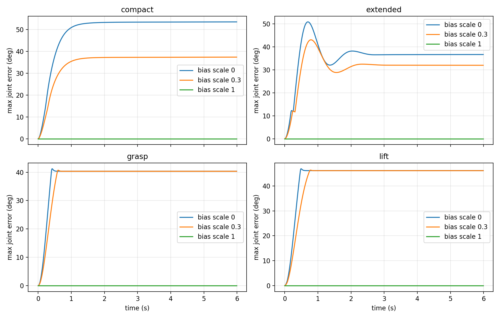

# 重力补偿仿真验证（2026-10-10）

## 1. 结论

当前模型的 MuJoCo 和 Pinocchio 重力方向、力矩计算一致；完整补偿能保持姿态。
SDK 正常运动中 J2/J3 的额外 `1.55` 系数，在匹配当前模型的仿真中造成过补偿，
因此现有 SDK 前馈不能视为已经与仿真一致。该历史系数仍保留，需明确标定依据后统一。

当前红色抓取/抬升姿态在 45 g 额外负载下的静态力矩低于电机额定值。
但一些其他姿态超过额定力矩：仿真允许峰值力矩，短时保持成功不能证明可以长期保持。
实体电机摩擦、编码器零位、力矩比例和真实反馈通信仍需要真机验证。
  
## 2. 方法与范围

- 唯一当前机械臂：`robot_arm.urdf`，其 D435/TCP 包装为 `rebotarm_with_d435.urdf.xacro`；
  物理模型为 `grasp_scene.xml` 引用的 `robot.xml`，未增加或替换机械臂模型。
- 电机参数使用 `motor_specs.yaml` 的 DM4340P、DM4310、PA43 额定/峰值力矩。
- MuJoCo 3.13.0、Pinocchio 4.1.0；随机种子 `20261010`；2000 个姿态重力对照。
- 30 组动态实验，每组 6 秒，物理步长 1 ms，CSV 每 10 ms 记录一次。
- 物理副本关闭环境接触，避免桌面/地面支撑造成虚假持姿；关节限位、夹爪等式、
  电机反射惯量、摩擦、阻尼及速度相关峰值限制保留。原抓取场景文件没有改变。
- 力矩计算/总输出限矩与实际 `mujoco_sync.py` 共用 `joint_control.py`；另通过实际
  `_update_physics` 循环的自动化测试验证缩放、持姿和总 PD 限矩。
- 正常物理控制补偿 `qfrc_bias`，含重力及科氏/离心项。独立 SDK 对照只使用 `g(q)`。
- 低增益试验为各轴 `Kp=5, Kd=2`；默认增益取混合电机配置：
  `Kp=[50,150,150,50,50,50]`、`Kd=[3,10,10,5,4,4]`。
- 静态额外负载按 TCP 点质量计算。动态持姿/转移未夹物体，也未加入额外物块负载；
  不是抓取功能、碰撞路径、实体拖动或负载加速验证。

`compact`/`extended` 分别选自采样中 TCP 水平半径最小/最大的候选姿态；候选通过
当前场景碰撞检查，TCP 高于 0.18 m、各关节距限位至少 0.12 rad。它们不是指定
home 姿态，也不代表所有机械臂自碰撞都已验证。准确六轴角度见 `results.json`。
`grasp`/`lift` 使用此前红色抓取实验记录的目标角度，`lift` 的 J4 位于 -90° 限位附近。

## 3. 两种动力学模型的重力一致性

各关节 2000 个姿态中的最大绝对差，单位 Nm：

| 关节 | J1 | J2 | J3 | J4 | J5 | J6 |
|---|---:|---:|---:|---:|---:|---:|
| 最大差 | <0.000001 | 0.007717 | 0.006148 | 0.003774 | 0.002893 | 0.001464 |

均小于既有模型对照门槛 `0.01 Nm`。MJCF 含 URDF 没有的 1 g 夹爪耦合代理，
因此不要求两者严格为零差。此对照验证模型转换一致性，不证明模型与实体完全一致。

## 4. 无补偿、部分补偿、完整补偿

抓取姿态 6 秒后结果，误差为六轴绝对误差最大值：

| 增益 | bias 比例 | 最大关节误差 | TCP 偏移 |
|---|---:|---:|---:|
| 低增益 | 0 | 40.357° | 292.737 mm |
| 低增益 | 0.3 | 40.336° | 279.795 mm |
| 低增益 | 1 | <0.001° | <0.001 mm |
| 当前默认 | 0 | 2.520° | 21.730 mm |
| 当前默认 | 0.3 | 1.759° | 15.281 mm |
| 当前默认 | 1 | <0.001° | <0.001 mm |

低增益的 0/0.3 两组 J2 都下垂到下限附近，因此最大误差相似；这不能解释为
部分补偿毫无作用，也不能把关节限位的支撑算作补偿成功。对应限位附近时间比例为
93.3% / 90.3%，已保存在 JSON 中。



匹配模型的完整 bias 补偿在四个姿态都能持姿；接近零误差也受理想模型和静摩擦影响。
高增益位置反馈能掩盖补偿不足：无补偿默认增益仍可停住，但 TCP 已偏移约 22 mm。

## 5. SDK 前馈的 1.55 系数

在同一物理模型和增益下，用 Pinocchio `g(q)` 替换 MuJoCo bias：

| 前馈 | 增益 | 6 秒最大误差 | TCP 偏移 |
|---|---|---:|---:|
| 原始 `g(q)` | 低增益 | 0.010° | 0.090 mm |
| J2/J3 ×1.55 | 低增益 | 28.962° | 296.240 mm |
| 原始 `g(q)` | 默认 | 0.002° | 0.010 mm |
| J2/J3 ×1.55 | 默认 | 1.374° | 12.339 mm |

额外系数的低增益组 J3 到达上限附近。默认增益虽然能阻止大幅偏转，仍存在过补偿误差；
起始 J2 前馈约 `6.546×1.55=10.147 Nm`，超过 9 Nm 额定值。

这复现的是 SDK 前馈公式，通过共用仿真控制器施加；没有连接 SDK/CAN 电机。
源码位置为 `third_party/reBotArm_control_py/reBotArm_control_py/controllers/rebotarm_endpose_controller.py`
的 `_loop_cb`。不能用本次结果直接推断实体电机力矩比例正确，也不能把 1.55 当作
当前模型所需的补偿常数。独立 SDK 拖动模式的默认 `tau_scale=0.3` 是另一个配置，
本次低增益固定目标实验没有复现其每帧更新位置目标的拖动行为。

## 6. 模型误差与外部扰动

保持名义前馈模型不变，仅改变物理模型中的移动机械臂质量/惯量，或末端与 D435
质心沿各自局部 x 轴移动 10 mm：

| 物理偏差 | 低增益最大误差 | 默认增益最大误差 |
|---|---:|---:|
| 移动部分质量 -10% | 7.242° | 0.250° |
| 移动部分质量 +10% | 7.351° | 0.250° |
| 末端/D435 质心 +10 mm | 0.107° | 0.013° |
| 质量 +10%，同时质心偏移 | 7.455° | 0.255° |

质量偏差下没有发散，但低增益误差明显，说明柔顺控制依赖准确模型；保持稳定
不等于保持精度。质心扰动只测试指定两个部件和一个方向，不能代表所有质心误差。

低增益完整补偿时，在 J2 施加 `1 Nm、0.25 秒` 的外部扰动，6 秒时残余误差
0.451°、TCP 偏移 3.998 mm。没有积分项或摩擦补偿，不能预期任何扰动后都恢复零误差。

## 7. 当前抓取姿态的力矩余量

45 g 负载按 TCP 点质量计算，表内为绝对静态力矩：

| 关节 | 额定 / 峰值 | 抓取需求 | 抬升需求 | 抓取额定利用率 |
|---|---:|---:|---:|---:|
| J1 DM4340P | 9 / 27 Nm | ≈0 | ≈0 | ≈0% |
| J2 DM4340P | 9 / 27 Nm | 6.697 | 5.980 | 74.4% |
| J3 DM4340P | 9 / 27 Nm | 4.333 | 4.285 | 48.1% |
| J4 DM4310 | 3 / 7 Nm | 0.538 | 0.395 | 17.9% |
| J5 PA43 | 5 / 13 Nm | 1.390 | 1.390 | 27.8% |
| J6 DM4310 | 3 / 7 Nm | 0.003 | 0.044 | 0.1% |

当前姿态具备静态额定余量，最紧张的是 J2。提高负载后：

| 额外负载 | 抓取 J2 / J3 | 抬升 J2 / J3 | 判断 |
|---|---:|---:|---|
| 1.5 kg | 11.558 / 7.924 Nm | 10.456 / 7.856 Nm | J2 超额定 |
| 2.5 kg | 14.898 / 10.392 Nm | 13.533 / 10.310 Nm | J2、J3 超额定 |

采样中通过当前碰撞检查的前伸姿态，空载 J2 为 13.760 Nm、J4 为 4.097 Nm，
分别达到额定的 152.9%、136.6%；TCP 更靠近基座的候选姿态也可能使 J4 超额定。
因此“收拢”不能代替逐轴力矩检查。

另做全关节范围随机 + 差分进化搜索，45 g 负载的最大需求分别约为
`[0,15.259,9.415,4.543,3.152,1.520] Nm`。这组搜索未过滤碰撞，各轴最差姿态不同，
也不是全局最大值的数学证明；不得将其直接当作可执行路径。

默认增益、3 秒平滑转移从抓取到抬升，随后保持到 6 秒：完整补偿末端最大关节误差
0.002°，最大额定利用率 73.8%，没有峰值限矩饱和；无补偿误差 2.277°。
该转移关闭接触、未携带物块，仅验证这条空载关节运动的控制与限矩。长期温升、
高速动作、真实夹持负载还需单独验证；热模型参数仍含估计值，本次没有验证长期热能力。

## 8. 修改与复现

新增仿真参数 `gravity_bias_scale`，默认仍为 `1.0`，joint/cartesian 物理控制均生效。
`joint_control.py` 供 ROS 节点与离线验证共用；SDK/UART 的控制参数、实体设备及模型
质量未改变。新增两份实验/绘图脚本和实际物理循环回归测试。

```bash
source /opt/ros/humble/setup.bash
source install/setup.bash
python3 scripts/validate_gravity_compensation.py
```

程序不启动 ROS 节点、不打开 CAN/UART；结果保存为
[results.json](validation/gravity/results.json) 与同目录 30 份时序 CSV。
JSON 含精确姿态、增益、每轴误差、力矩、限矩饱和比例、限位附近时间比例及模型文件哈希。
绘图使用系统 Python/Matplotlib，避免系统 Matplotlib 与用户 NumPy 2.x 的 ABI 冲突。

仿真节点也可直接切换比例；下面是低增益对照，不是完整抓取参数：

```bash
ros2 launch rebotarm_mujoco_rs mujoco_rs.launch.py \
  authority_mode:=true simulation_mode:=physics enable_task_tools:=false \
  arm_kp:='[5,5,5,5,5,5]' arm_kd:='[2,2,2,2,2,2]' gravity_bias_scale:=0.3
```

两包构建通过：`rebotarm_mujoco_rs`、`rebotarm_bringup`。
6 项相关测试通过，包括真实物理循环补偿缩放、总输出限矩、持姿与下垂，以及既有模型对齐检查。
统一启动入口的参数检查通过，`gravity_bias_scale` 默认值为 `1.0`。
