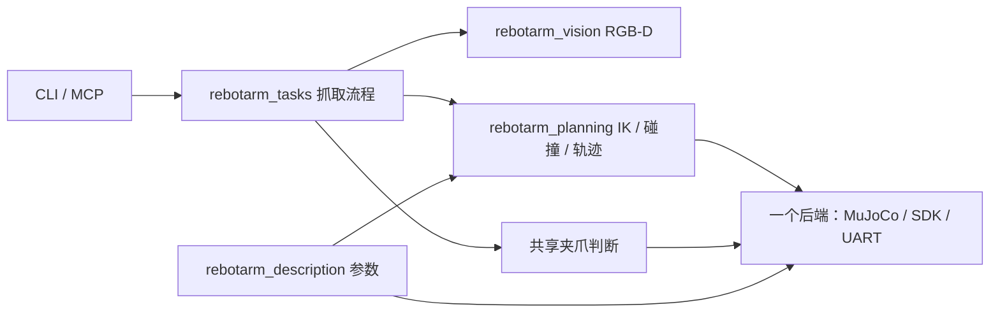

# `src` 目录说明

这个工作空间有三项用途：**RViz 真机示教**和**视觉抓取**共用 ROS 位置控制链；**乒乓球**直接在独立 MuJoCo 环境里控制和训练。六轴机械臂参数共用，末端工具与场景分别维护。

正式位置接口统一为 `/<arm_namespace>/arm/command/position`，一条消息含六轴绝对角度和非负限速。当前默认仍由 `task_server` 执行轨迹；新增的 `ros2_control` 层为可选迁移路径。MoveIt/Servo 的分工、旧包去留与高速颠球路线见 [控制接口说明](control_interfaces_zh.md)。

当前模型已更新为 2026-10-26 提供的 CAD，包含腕部 D435。离线模型、笛卡尔 IK、规划与执行结果见 [新模型验证](validation/cad_model_20261026.md)。

## 1. 先看哪些文件

| 想做什么 | 从哪里开始 |
|---|---|
| 跑完整抓取 | `rebotarm_bringup/launch/grasp.launch.py` |
| 看抓取流程 | `rebotarm_tasks/rebotarm_tasks/pick_task.py` |
| 跑一维颠球、训练 PPO | `rebotarm_pingpong/rebotarm_pingpong/cli.py` |
| 改机械臂结构/限位 | `rebotarm_description/urdf/robot_arm.urdf` |
| 改电机参数 | `rebotarm_description/config/rebotarm_hardware.yaml` |
| 改球拍/球/外部相机 | `rebotarm_description/config/pingpong.yaml` |

下文中的路径均相对于 `src/`，同步脚本在工作空间根目录的 `scripts/`。

## 2. 两条任务链

### 抓取：共享任务和规划，选择一个设备后端



入口为 `grasp.launch.py backend:=mujoco|sdk|uart`。一次运行只启动一个后端，共享规划独占机械臂 Action。抓取仿真使用 `grasp_scene.xml → robot.xml`，末端是夹爪和腕部 D435。

### 乒乓球：独立物理循环

```text
pingpong.yaml + 共用六轴参数 → 六轴球拍模型 + 自由球场景
双相机 RGB → 球检测/三角测量/带时间戳估计
  → 相机横向追踪/竖直基线 + PPO 五维残差 → MIT 六轴限矩控制
  → 球拍/球接触 → 独立评估和可视化
```

模型移除第七电机与夹爪，换成固定球拍。球采用空心薄壳惯量，可自由移动和旋转；两个乒乓球 scene 都没有 XY 约束。“一维”是历史兼容入口名称，当前动作是 XYZ 速度和两个局部拍面倾角速度；侧飞、漏接仍会失败。

控制和 PPO 的球位置、速度来自两台固定外部相机的 RGB 图像；包含有限帧率、曝光、延迟、遮挡及标定误差，丢失视觉不会回退真值。仿真真值只用于初始化、物理、奖励和独立误差统计。训练不经过 ROS，不发送真机命令。

## 3. 各包负责什么

| 包 | 职责 | 主要文件/入口 |
|---|---|---|
| `rebotarm_description` | 共用机械臂、末端工具、模型与参数 | `urdf/`、`mjcf/`、`config/`、`parameters.py`、`pingpong_model.py` |
| `rebotarm_msgs` | ROS 消息、服务和 Action | `msg/`、`srv/`、`action/` |
| `rebotarm_bringup` | 组合节点、选择后端 | `launch/grasp.launch.py` |
| `rebotarmcontroller` | SDK/CAN 真机驱动及假驱动 | `rebotarm_controller.py`、`hardware_config.py` |
| `rebotarm_uart` | ROS→115200 七轴固定 72/131 字节 UART→STM32 | `bridge.py`、`link.py`、`protocol.py`、`transport.py` |
| `rebotarm_mujoco_rs` | 抓取物理仿真、模拟相机、重力扫描 | `mujoco_sync.py`、`scene_camera.py`、`rs_gravity_scan` |
| `rebotarm_planning` | 有界 IK、碰撞场景、轨迹执行 | `task_server.py`、`collision_planner.py`、`sdk_model.py` |
| `rebotarm_vision` | D435/仿真共用的 YOLO RGB-D 检测；颜色分割保留为备用 | `yolo_detection.py`、`rgbd_detection.py`、`rgbd_detector.py`、`real_d435.launch.py` |
| `rebotarm_tasks` | 抓取状态机、夹爪等待与 CLI | `pick_task.py`、`gripper.py`、`pick_cli.py` |
| `rebotarm_pingpong` | RGB 双目定位、颠球控制、Gym 环境、PPO 与评估 | `vision.py`、`control.py`、`env.py`、`train.py`、`evaluation.py`、`cli.py` |
| `rebotarm_agent` | MCP 与文本工具，调用共享任务 | `rebotarm_mcp_server.py` |
| `rebotarm_moveit_config` | MoveIt/RViz/ros2_control 配置 | `config/`、`launch/` |
| `rebotarm_ros2_control` | 可选的六轴 SystemInterface 与 JTC，复用 UART 后端 | `src/uart_system.cpp`、`launch/uart_control.launch.py` |
| `rebotarm_moveit_demos` | MoveIt 抓放、画矩形示例 | `launch/`、`config/` |

`rebotarm_mujoco_rs` 的 `rs` 是历史命名。`third_party/` 放外部 SDK；`archive/` 放历史工程；`build/`、`install/`、`log/` 是生成物。

规划器、MuJoCo、UART 和 SDK 共用 `ArmPositionCommand`；参数/消息校验集中在 description 的 `parameters.py` / `command_interface.py`。限速 0 暂停目标轨迹，不表示反向速度。兼容逐关节话题需显式选择，不与批量话题同时订阅。PPO 尚未接入真机接口。

UART 只有一套协议：`bridge` 接 ROS，`link` 管周期和超时，`protocol` 编解码，`transport` 读写串口。72 字节中的位置是相对 MCU 启动零点的绝对目标，速度字段是固件位置轨迹限速；当前已烧录 STM32 仍在内部做 5 ms 插值。`posvel_to_mit` 和 `hold` 是上游适配器/示例。使能需显式调用服务；停发后的实际停机由 STM32 500 ms 看门狗完成。

## 4. 文件命名

Python 包通常有：

- `package.xml`：ROS 包依赖；`setup.py`：Python 安装与命令入口。
- `launch/`：启动哪些节点，以及参数怎样传递。
- `config/`：设备或任务参数。
- 与包同名的 Python 目录：具体实现。

`rebotarm_msgs`、`rebotarm_moveit_config` 使用 CMake。新增控制算法先写成独立函数或类，再接 ROS；颠球训练无需加入 ROS 节点。

## 5. 参数在哪里改

### 5.1 唯一来源与生成文件

| 参数 | 修改源 | 消费方式 |
|---|---|---|
| 关节轴/原点/限位、连杆质量/惯量 | `description/urdf/robot_arm.urdf` | URDF 直接读取；同步到抓取和球拍 MJCF、UART |
| 电机 ID/型号、各关节 MIT 增益、物理规格、UART 策略 | `description/config/rebotarm_hardware.yaml` | Kp/Kd 只改 `models.*.overrides.joints[].MIT`；UART 按槽位自动生成 |
| 相机外壳安装、质量/惯量 | `description/urdf/robot_arm.urdf` 的 `camera_joint/camera_link` | CAD 实体模型；相机碰撞由 Xacro 按需加入 |
| 抓取 TCP 与相机传感器坐标 | `description/config/d435_mount.yaml` | Xacro/规划读取；同步抓取 MJCF |
| 球拍、乒乓球、固定相机、颠球控制与训练 | `description/config/pingpong.yaml` | 生成独立 MJCF；颠球环境读取 |
| 抓取位姿/阈值、规划策略 | `tasks/config/pick_*.yaml`、`planning/config/` | 任务与规划分别读取 |
| MoveIt 规划/速度策略 | `moveit_config/config/` | MoveIt 读取，可比设备限制更保守 |

表中 `description/`、`tasks/`、`planning/`、`moveit_config/` 分别简写对应的 `rebotarm_*` 包。

**生成文件不要手改**：`mjcf/robot_pingpong.xml`、两个乒乓球 scene、`config/motor_specs.yaml`、bringup 硬件 YAML、UART 的 `uart.yaml` / `uart_grasp.yaml`。共享 `robot.xml` 中的运动学/限位/惯量也由同步维护，但其中 mesh 和碰撞几何仍可编辑。

### 5.2 修改后的操作

```bash
python3 scripts/sync_robot_parameters.py
python3 scripts/sync_robot_parameters.py --check
colcon build --symlink-install
```

同步脚本先验证全部参数，再生成九个派生文件。新增乒乓球参数不会重写抓取场景。固件限位与实体标定仍需独立核验；生成配置不能替代实测。

## 6. 启动方式

所有命令都在工作空间根目录执行。每个设备后端只能启动一套；尤其不要同时启动两个 UART bridge。

| 模式 | 正式入口 | 是否会驱动真机 |
|---|---|---:|
| 抓取仿真 | `grasp.launch.py backend:=mujoco` | 否 |
| UART 通信/保持 | `start_uart_bridge.sh <串口>` | 是（需单独 `enable`） |
| UART 真机抓取 | `grasp.launch.py backend:=uart port:=...` | 是 |
| SDK/CAN 真机抓取 | `grasp.launch.py backend:=sdk channel:=can0` | 是 |
| MoveIt/RViz 仿真 | `moveit_sim.launch.py` | 否 |
| RViz/MoveIt 真机示教 | `hardware.launch.py`（先启动 UART 或 SDK 后端） | 是 |
| 乒乓球/PPO | `python3 -m rebotarm_pingpong.cli ...` | 否，不连接 ROS/UART |

### 6.1 抓取仿真

```bash
source /opt/ros/humble/setup.bash
source install/setup.bash
MUJOCO_GL=egl ros2 launch rebotarm_bringup grasp.launch.py backend:=mujoco use_viewer:=false
# 在另一个同 ROS_DOMAIN_ID 的终端：
ros2 run rebotarm_tasks pick --color red --action-timeout-padding-sec 40
```

抓取入口默认使用自己训练的 YOLO26 权重 `models/best.pt`、GPU 0。也可传
`yolo_model:=/绝对路径/best.pt`，无需修改识别代码。YOLO 文件在
`src/rebotarm_vision/rebotarm_vision/yolo_detection.py`，D435 深度和 TF 由
`rgbd_detector.py` 负责；权重缺失或 CUDA 不可用时会明确报错。
`pick --color auto` 可选择 YOLO 目标；上述 `--color red` 需模型类别为 `red` 或配置
`yolo_class_map`。颜色分割仅在显式添加 `detector_backend:=color` 时启用。

电脑较慢时可以使用一键脚本：

```bash
./scripts/start_camera_sim.sh
```

### 6.2 UART 真机通信和保持当前位置

这个入口只启动 UART bridge 和位置适配器，不启动抓取任务：

```bash
./scripts/start_uart_bridge.sh /dev/ttyCH343USB0
```

UART 桥启动后即可在另一个终端执行 enable；失能阶段的过期反馈、初始化标志和旧运行位不阻止首帧：

```bash
./scripts/start_uart_bridge.sh enable
# 停止发送；STM32 看门狗随后失能
./scripts/start_uart_bridge.sh disable
```

使能服务不检查反馈，首帧写入成功即返回“指令已发送”。后台持续发送零增益、零限速、零前馈帧；七轴新鲜运行反馈齐全后，状态中的 `enabled` 才变为 `true` 并接入正常目标。若后台确认超时，状态报告 `post-enable feedback timeout` 并停发；`te (3)` 自身的 100 ms 反馈保护仍然有效。
若报关节越限，错误会列出具体角度与范围；主机已处理零位附近的编码量化差，明显偏差仍需核对启动零点与 URDF 的对应关系，见 [UART 排查说明](uart_host_guide_zh.md#使能报关节越限)。

它默认使用 115200 波特率、关闭重力前馈。这个入口不能接收 RViz 的规划轨迹，也不会自动抓取。
本机 CH343 使用 WCH 厂商驱动，设备名为 `/dev/ttyCH343USB0`；内核更新后若找不到串口，见 [CH343 驱动安装](uart_host_guide_zh.md#ch343-插上后没有串口节点)。

### 6.3 UART 真机抓取

这个入口启动 UART、位置适配器、任务规划器和真实 D435：

```bash
source /opt/ros/humble/setup.bash
source install/setup.bash

ros2 launch rebotarm_bringup grasp.launch.py \
  backend:=uart \
  port:=/dev/ttyCH343USB0 \
  start_camera:=true \
  gravity_feedforward:=false
```

确认反馈正常后使能，再运行抓取任务：

```bash
./scripts/start_uart_bridge.sh enable
ros2 run rebotarm_tasks pick \
  --config "$PWD/src/rebotarm_tasks/config/pick_uart.yaml" \
  --color red --action-timeout-padding-sec 40
```

停止时先停止任务，再执行 `./scripts/start_uart_bridge.sh disable`，最后退出 launch。不要再启动 `start_uart_bridge.sh <串口>`，因为上面的 `grasp.launch.py` 已经启动了 UART bridge。

完成零位、质量、方向和低速前馈验证后，重启时才把参数改为 `gravity_feedforward:=true`：

```bash
ros2 launch rebotarm_bringup grasp.launch.py \
  backend:=uart port:=/dev/serial/by-id/<STM32设备> \
  start_camera:=false gravity_feedforward:=true
```

这仍是位置控制加重力前馈，不是拖动示教模式；启动后仍要先确认反馈，再调用 `enable`。

### 6.4 UART 真机配合 RViz/MoveIt 示教

纯 RViz 示教关闭相机。先启动 UART 与轨迹服务（不会自动执行抓取）：

```bash
source /opt/ros/humble/setup.bash
source install/setup.bash
ros2 launch rebotarm_bringup grasp.launch.py \
  backend:=uart port:=/dev/ttyCH343USB0 \
  start_camera:=false gravity_feedforward:=false
```

第二个终端启动 MoveIt；机械臂 TF 由上面的后端发布：

```bash
source /opt/ros/humble/setup.bash
source install/setup.bash
ros2 launch rebotarm_moveit_config hardware.launch.py \
  arm_namespace:=rebotarm use_rviz:=true
```

第三个终端使能：

```bash
./scripts/start_uart_bridge.sh enable
```

RViz 默认显示 `MotionPlanning` 和末端目标标记。选择工具栏 **Interact**，拖动箭头平移、圆环旋转，先点击 **Plan** 预览，再点击 **Execute** 执行。纯示教不需要 RGB-D 检测或手眼标定。

若电机失能且 `/rebotarm/uart/status` 报 `upstream joint command timeout`，表示上游 MIT 指令曾中断。故障会锁存，即使 `targets_fresh=true` 也不会自动恢复。更新后先停止旧 launch、重启 UART/轨迹后端，再显式使能并重新 Plan；未重启时需先 `disable` 清故障。详见 [UART 超时排查](uart_host_guide_zh.md#rviz-执行时失能upstream-joint-command-timeout)。

零位的 `link2/link4`、`link2/link5` 是用户确认的机械限位接触，`link5/gripper_end` 是装配面接触，MoveIt 的 SRDF 和执行端的 `hardware_scene.xml` 已同步允许这些连杆对接触（对这些连杆对的所有姿态生效）。执行端对其他自接触采用 0.05 mm 数值容差；真机模式还用 CAD 三角网格复核双网格的凸包候选，避免将零件空隙误判为碰撞，实际网格相交仍会拒绝执行。桌面、外部物体和非双网格代理保持原有保守检查，外部余量为 2 mm。修改后需重启轨迹服务，重新点击 **Plan**；SRDF 修改还需重启 MoveIt。

实物已摆到零位时，J5 约 `0.00744 rad` 的读数按用户确认视为零。配置入口为 `rebotarm_hardware.yaml → uart.transport.feedback_zero_tolerance_rad`，按 J1～J6 排列，当前仅 J5 开启 ±0.01 rad 死区。该范围内的 `joint_states` 为零，RViz 与执行端使用同一结果；范围外保留实测角度。死区内小运动不再分辨，这不是全行程零偏标定。`/rebotarm/uart/status` 的 `feedback_position_rad` 及逐电机 `state` 仍显示原始读数。修改配置后运行 `python3 scripts/sync_robot_parameters.py`，重启 UART/轨迹后端和 MoveIt，再重新 **Plan**。

真机规划起点碰撞时直接报错，不再随机挪动起点。执行日志记录起点、终点、每秒的目标/实测角度及最终取消或失败原因，`FollowJointTrajectory` 同时提供跟踪反馈。空闲保持会锁存目标，避免目标随关节下滑不断改变；重新使能时清除旧目标并从实测位置对齐。详见 [执行不动排查](uart_host_guide_zh.md#rviz-plan-成功但执行不动)。

新 CAD 已安装 D435，MoveIt 和执行端均默认 `d435_collision:=true`，即使 `start_camera:=false` 也检查相机外壳。只有实物拆掉相机时，才在两条启动命令中同时传 `d435_collision:=false`。

相机实体的位置来自 CAD；`camera_link` 原点不在镜头中心。`d435_mount.yaml` 现在描述 `camera_link → camera_sensor_frame`，目前为 CAD 前表面的估计值，光学外参待核对。纯 RViz 示教可不启动图像；真机视觉抓取需补齐镜头外参和手眼验证。

真机执行仍使用共享轨迹服务的限位、反馈和碰撞检查；`hardware_scene_calibrated=false` 会阻止发送运动轨迹。这里的场景标定是确认桌面/固定物体相对 `base_link` 的位置，可用尺寸测量完成，不要求相机。MCU 上电置零只定义编码器零点，实物姿态与 URDF 零姿态仍须一致，详见 [抓取执行与迁移](grasp_execution_zh.md#21-标定文件)。

真机轨迹目标允许相对实测位置最多领先 `max_command_lead_rad=0.20` rad；起动力矩是否足够仍由实际 Kp、负载和电机状态决定。路径和终点等待共用逐轴停滞检查：任一误差超过 `0.025 rad` 的轴，连续 `motion_stall_timeout_sec=4.0` 秒没有累计朝目标移动至少 `0.002 rad` 就中止。两项参数在 `src/rebotarm_planning/config/planning_hardware.yaml` 修改。持续发包、切换路点和其他轴运动都不算该轴有进展；碰撞、限位、反馈过期和 0.35 rad 跟踪保护仍有效。

指令到终点后继续等待实物，不再设置固定的 4 秒终点等待期限。六轴误差均不超过 `0.025 rad`（约 1.43°）且连续保持 `0.2 s` 才报告成功，成功后继续保持规划终点；取消或失败则撤回到实测姿态。若反复 Execute 只动一点，要看 `trajectory aborted` 的具体轴：已有日志中 J5 实测停在约 `+0.06008 rad`，主机目标约 `−0.14030 rad`，并非到位。这样的停滞仍会失败，需要核对 J5 的实际响应，不能通过反复执行代替调试。见 [执行修复验证](validation/trajectory_execution_20261103.md)。

RViz 用 MoveIt 的 KDL IK 和 OMPL 规划，默认视觉抓取用任务服务的有界 IK 与自定义碰撞规划，两者共用后续轨迹执行链。流程对比见 [控制接口说明](control_interfaces_zh.md#rviz-与抓取是否使用相同的规划)。

当前 URDF 六个旋转关节的 `axis` 都是局部 `+Z`，正角是右手定则；URDF 不记录“顺时针/逆时针”或电机厂商方向。UART 目前直接传递反馈和目标角度，没有自动翻转 PA43 的方向。因此，实物零位一致只解决偏置，仍要逐轴用很小的正角验证 J5 的 PA43 方向；`uart.gravity.joint_direction` 只影响重力前馈，不会修正 RViz 运动方向。

`base_link` 的原点不是 CAD 底面：当前 MJCF 碰撞网格最低约为 `z=-0.042275 m`；按用户提供的“桌面贴着底座底面”，`planning_hardware.yaml` 已更新为 `table_top_m: -0.042275`。桌面贴着基座底面时，核实脚垫或底板厚度；确认与实物一致后将 `hardware_scene_calibrated` 设为 `true`，轨迹服务才允许真机执行。

### 6.5 SDK/CAN 真机抓取

```bash
source /opt/ros/humble/setup.bash
source install/setup.bash
ros2 launch rebotarm_bringup grasp.launch.py \
  backend:=sdk channel:=can0 \
  start_camera:=true \
  gravity_feedforward:=false
```

确认 `/rebotarm/arm_status` 和视觉反馈正常后调用：

```bash
ros2 service call /rebotarm/enable std_srvs/srv/Trigger '{}'
ros2 run rebotarm_tasks pick \
  --config "$PWD/src/rebotarm_tasks/config/pick_sdk.yaml" \
  --color red --action-timeout-padding-sec 40
```

### 6.6 MoveIt 仿真

```bash
source /opt/ros/humble/setup.bash
source install/setup.bash
ros2 launch rebotarm_moveit_config moveit_sim.launch.py
```

这个入口使用假 ros2_control 和 RViz，不能连接 UART 或 CAN 真机。

### 颠球仿真与训练

```bash
export PYTHONPATH="$PWD/src/rebotarm_description:$PWD/src/rebotarm_pingpong:$PYTHONPATH"
MUJOCO_GL=egl python3 -m rebotarm_pingpong.cli baseline --episodes 3
python3 -m rebotarm_pingpong.cli view
# 电脑较慢时仅降低交互预览的 RGB 采样频率；训练和评估仍用正式配置
python3 -m rebotarm_pingpong.cli view --sensor-fps 20
MUJOCO_GL=egl python3 -m rebotarm_pingpong.cli train --steps 200000 --envs 2 --output artifacts/pingpong/my_run
MUJOCO_GL=egl python3 -m rebotarm_pingpong.cli evaluate --model artifacts/pingpong/my_run/final_model.zip --output artifacts/pingpong/my_eval
```

依赖安装、相机分析与实验结果见 [乒乓球仿真与 PPO](pingpong_zh.md)。

MoveIt 的 `demo.launch.py` / `moveit_sim.launch.py` 使用假 ros2_control；`hardware.launch.py` 对接实际轨迹 Action，属于另一种规划工作流。

## 7. 旧入口与兼容

### 7.1 是否保留兼容入口

现有转发供旧脚本迁移，新代码直接使用正式包。`rebotarm_mujoco_rs` 的物理/相机功能和 `rebotarmcontroller` 的 SDK/Fake 仍被引用，不能整包直接删。Agent 默认关闭，Demo 可退出主线；清理引用后才删除可选包，详见 [包的保留与退出](control_interfaces_zh.md#4-哪些包保留哪些可以退出主线)。

| 旧入口 | 正式位置 |
|---|---|
| MuJoCo 的 `task_server`、`collision_planner`、`sdk_model`、`trajectory_progress` | `rebotarm_planning` |
| MuJoCo 的 `rgbd_detection`、`scene_detector` | `rebotarm_vision` |
| Agent 的 `rebotarm_pick` | `rebotarm_tasks pick` |
| MuJoCo 的 `rs_pingpong_controller` | 转发至 tasks 的旧正弦运动示例 |

旧 `rebotarm_tasks pingpong_controller` 只做正弦运动，收到球信息也不参与控制。本文的自由球颠球与 PPO 使用 **`rebotarm_pingpong`** 或 `python -m rebotarm_pingpong.cli`；`PingPong1DEnv` 仅保留类名兼容。

`mujoco_rs_sync`、`rs_scene_camera`、`rs_gravity_scan` 是仿真包实际功能。不同粒度的 SDK/UART/MoveIt launch 也仍有用途。

## 8. 验证与边界

```bash
source install/setup.bash
python3 scripts/sync_robot_parameters.py --check
ROS_DOMAIN_ID=199 MUJOCO_GL=egl python3 -m pytest -q tests src/rebotarm_uart/test
ROS_DOMAIN_ID=166 MUJOCO_GL=egl python3 tests/launch_grasp_smoke.py red
```

- 抓取以实测夹爪状态、视觉抬升和保持确认成功；仿真另检查双指接触。
- 颠球记录反弹次数、顶点误差、视觉误差和失败原因；掉拍即失败，达到次数后仍须坚持到回合结束。
- 抓取的低速规划接口不能直接代替颠球实时控制。当前 PPO 不连接真实相机或电机。
- 旧的锁 XY、真值观测以及 26 维一维动作 PPO 已失效。当前五维控制已能真实横移和改变拍面，但随机化仍有漏拍/关节限位种子；接触、气动力和电机响应仍需实测标定，薄壳惯量不等于模拟壳体形变。
- 球拍仿真沿用简化的自碰撞处理；球与机械臂/地面仍可接触。随机化下的横向接球和真机高速控制仍需继续验证。

详细资料：[控制接口与路线](control_interfaces_zh.md) · [项目参数手册](project_guide_zh.md) · [抓取执行与迁移](grasp_execution_zh.md) · [乒乓球仿真与 PPO](pingpong_zh.md) · [UART 主机指南](uart_host_guide_zh.md) · [重力验证](gravity_compensation_validation_zh.md)。
