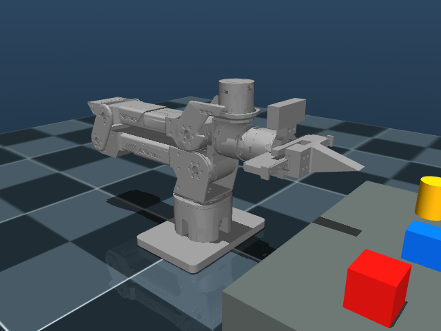

# 新 CAD 模型适配与验证（2026-10-26）

## 1. 适配内容

来源：`local_mvp3pz5c_j4l65s_urdf_stl.zip`。

SHA256：`fde9d589aaa6c82ac09599d090141714b7c51d717109f8c85148a02d9d8e8d51`。

- 主 URDF 已换成新 CAD 的结构、网格、质量、质心和惯量，包含 `camera_joint/camera_link`。引用的 107 个网格均已安装，可由 RViz 加载。
- 保留工程的 `base_link` 工作区朝向、六轴关节名与控制顺序；增加空基座帧避免 KDL 的根连杆惯量限制。工具坐标重新表达时，对几何、惯量和子关节做逆变换，保持 CAD 装配位置。
- 保留左指负行程、右指正行程的 ROS 约定，以及原有 UART 电机 ID、增益、限速和协议。新 CAD 的六轴角度范围与旧配置一致；保留原项目 effort/velocity 上限，真机运行还受集中硬件配置限制。
- 同步抓取 MJCF、独立球拍 MJCF 和场景中的连杆引用。网格位姿使用与 URDF RPY 等价的四元数；相机质量只在主 URDF 中维护一次。
- MoveIt 和执行端默认检查实体相机，暂停图像不关闭碰撞。执行端继续用 CAD 三角网格复核凸包候选；自碰撞与外部障碍检查保留。
- 按“桌面贴着底座底面”，真机桌面高度更新为 `base_link` 下的 `-0.042275 m`。有额外底板或脚垫时按实际尺寸修改 `planning_hardware.yaml`。

压缩包的导出报告提示 `part_069`、`part_085`、`part_088` 未分配到任何 link。网格文件已保留；它们未被源 URDF 引用，因此没有擅自装到运动链中。后续 CAD 导出应补齐归属。



## 2. 相机坐标的区别

```text
主 URDF：gripper_end → camera_joint → camera_link（CAD 外壳、惯量）
YAML：  camera_link → camera_sensor_frame（传感器外参）
光学链：camera_sensor_frame → camera_color/depth_frame → optical_frame
```

源文件的 `camera_joint` 为零，但相机实体顶点在 CAD 全局坐标中。因此 `camera_link` 原点不在镜头中心。适配保留了实体安装位置，并单独建立传感器坐标。

`d435_mount.yaml` 中的传感器外参目前是 CAD 前表面估计，状态为 `cad_front_face_estimate_optics_unverified`。它能用于模型与仿真一致性检查，**不能视为已完成镜头外参或手眼标定**。真机视觉抓取前需用真实镜头坐标、RealSense 内部 TF 和已知标定点验证。

TCP 已随新夹爪调整到仿真接触面的中心；真机精确抓取仍需核对实际工具点。此前模型上的抓取、重力或 PPO 实验结果不能直接作为新模型的验证结果，旧策略需重新评估。

## 3. 实际验证结果

测试均在独立 ROS 域中运行，没有连接 UART/CAN、使能或驱动真机。

| 检查 | 结果 |
|---|---|
| 相关 ROS 包构建、Xacro 展开、URDF 解析 | 通过 |
| MoveIt 与 MuJoCo 的关节范围、TCP、相机 FK、重力一致性 | 通过 |
| URDF STL 顶点与 MuJoCo 编译后顶点的世界位置比较 | 两组关节姿态、全部视觉网格，误差小于 1 µm |
| 零位与编码量化偏差起点、离开机械限位 | 通过 |
| 真实自碰撞、外部障碍物、相机碰撞开关 | 能拒绝碰撞；未整体关闭自碰撞 |
| MoveIt 假控制器链：零位 → J3 约 0.12 rad | 规划与执行成功，关节状态改变 |
| MoveIt → task_server → 位置接口 → MuJoCo 物理链 | 笛卡尔 IK、规划与执行成功 |

物理链测试以可达 TCP 位姿为目标，检查位置和姿态约束，并检查执行后实测关节的 FK。一次记录：17 个轨迹点，J3 终点约 `0.12130 rad`，TCP 位置误差约 `0.19 mm`、姿态误差约 `0.74°`。这验证了一条可达路径；目标仍需在关节范围内并避开碰撞，不能保证任意拖动目标可达。

模型、参数传播、碰撞与场景相关回归 28 项通过；重力补偿和 MoveIt 控制器接口 10 项通过。抓取仿真基础和乒乓球入口的一组 16 项回归也通过（与前述检查部分重叠）。没有完成新模型上的真实抓取、真机轨迹或 PPO 重新训练。

复现核心验证：

```bash
source /opt/ros/humble/setup.bash
source install/setup.bash
python3 scripts/sync_robot_parameters.py --check

MUJOCO_GL=egl python3 -m pytest \
  tests/test_model_alignment.py tests/test_parameter_sources.py \
  tests/test_mesh_collision.py tests/test_hardware_scene.py \
  tests/test_sim_upgrade.py -q

ROS_DOMAIN_ID=197 MUJOCO_GL=egl python3 tests/launch_moveit_model_smoke.py --backend mock
ROS_DOMAIN_ID=198 MUJOCO_GL=egl python3 tests/launch_moveit_model_smoke.py --backend mujoco
```

## 4. RViz 启动

更新模型后先停止旧 launch，再构建并重新加载环境：

```bash
source /opt/ros/humble/setup.bash
colcon build --symlink-install
source install/setup.bash
```

### 只验证 RViz 规划执行（不连接电机）

```bash
ros2 launch rebotarm_moveit_config demo.launch.py
```

### UART 真机示教

终端 1，替换实际串口；关闭图像但保留相机外壳碰撞：

```bash
ros2 launch rebotarm_bringup grasp.launch.py \
  backend:=uart port:=/dev/ttyCH343USB0 \
  start_camera:=false d435_collision:=true gravity_feedforward:=false
```

终端 2：

```bash
source /opt/ros/humble/setup.bash
source install/setup.bash
ros2 launch rebotarm_moveit_config hardware.launch.py d435_collision:=true
```

终端 3：

```bash
./scripts/start_uart_bridge.sh enable
```

RViz 选择 `arm` 和工具栏 **Interact**；先小幅拖动 TCP，点击 **Plan**，预览后点击 **Execute**。真机示教使用 `hardware.launch.py`；`demo.launch.py` 执行的是假控制器。

真机的零位、方向、通信与负载状态仍由真实反馈验证。本次未通电验证；不要据离线测试结果认定真机已经执行成功。

## 5. 真机执行排查（2026-10-26 晚）

随后读取现场日志与反馈，发现三项独立问题。本次排查没有发送运动或使能指令。

| 项目 | 现场证据与结论 |
|---|---|
| 通信与使能 | UART 无坏帧，七轴反馈新鲜、组标志为 `[3, 3, 3]`，状态 `ENABLED`。此次不是串口或未使能导致。 |
| 第一次轨迹跟踪 | J3 目标推进到约 `0.201 rad`，实测仅约 `0.001 rad`。轨迹已到达主机 UART 后端，但没有形成足够的实测运动；主机日志不能代替 STM32/CAN 的指令确认。 |
| 执行时间冲突 | 原轨迹 `2.118 s`，MoveIt 按 `×1.2 + 0.5 s`，在约 `3.04 s` 取消；后端本身会按实测进度与限速延长轨迹。已对默认 task_server 路径关闭 MoveIt 的固定时长监控，保留后端的反馈、碰撞、跟踪误差和无进展检查；可选 JTC 保留原监控。 |
| 后续起点碰撞 | 实测 J4 约 `-0.00362 rad` 时，MoveIt 报 `link2/link5` 碰撞；执行端 CAD 三角网格也相交。MoveIt 返回的接触深度约 `3.81 mm`，执行端的凸包距离约 `-0.167 mm`，两者定义不同，均不能直接当作实体穿透的测量值。 |

当前未启用重力前馈。按新 CAD 在该姿态估算，J2/J3 静态重力矩约 `1.35/2.75 Nm`；当前两轴 `Kp=3.1`，允许目标领先 `0.20 rad`，对应位置比例项约 `0.62 Nm`。这提示当前增益可能不足以克服负载，仍需结合固件实际执行与力矩反馈验证，不是已完成的真机辨识。`uart.firmware.torque` 限制的是前馈字段，不是电机内部 PD 总输出。

此次没有提高真机增益或开启重力前馈，也没有增加碰撞豁免。接下来需核对 `link2/link5` 是否是已知机械限位接触，并在有支撑的条件下逐轴验证指令执行、方向和带载响应，再恢复整条 RViz 轨迹。

修复后，控制器选择与轨迹跟踪相关的 22 项回归通过，MoveIt 包构建通过。独立 ROS 域的 MoveIt → task_server → MuJoCo 物理链再次完成 IK、17 点规划与执行，J3 到达约 `0.11996 rad`，TCP 位置误差约 `0.60 mm`。这只验证软件链；真机带载运动仍未验证。固定时长监控的修改在重新启动 MoveIt `hardware.launch.py` 后生效。
